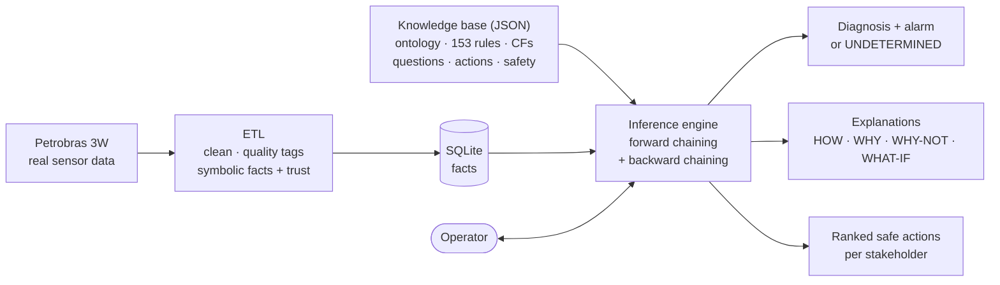
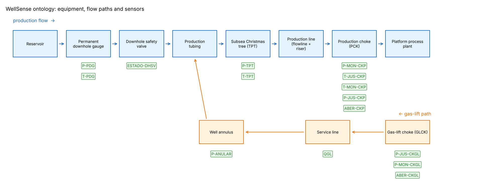
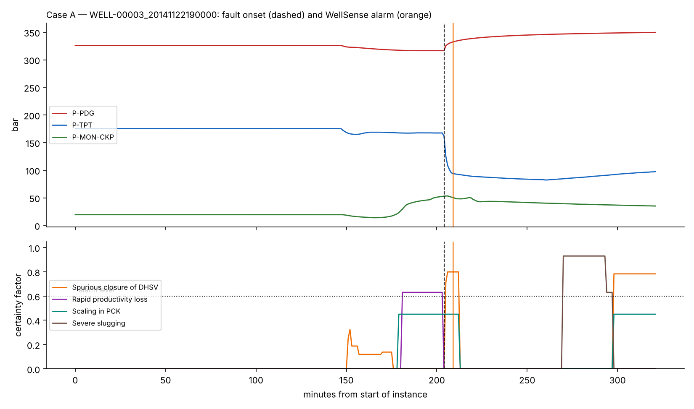
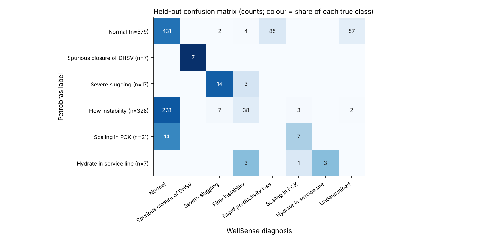

<div align="center">

# 🛢️ WellSense

### A Hybrid Knowledge-Based System for Fault Diagnosis and Maintenance Decision Support in Offshore Oil Wells


-A84A15)

**Knowledge-Based Systems (CT-359) · Complex Computing Problem**
NED University of Engineering & Technology · Section B (AI) · Submitted to **Miss Mehar Fatima**

</div>

---

## 📌 What is WellSense?

Offshore oil wells suffer faults that are **rare, fast and expensive**: a safety valve that closes by itself, an ice-like hydrate plug in a pipeline, violent slugging flow. Their sensors are often **missing or frozen**, and the people who must decide what to do — safety, production and finance — **want different things**.

WellSense is an expert system that watches real well sensors and:

- 🔍 **diagnoses** which of 9 fault types is happening, minute by minute;
- 💬 **explains** every conclusion — *how* it decided, *why* it asks a question, *why not* another fault;
- ❓ **asks the operator** targeted questions when the sensors are not enough;
- 🧯 **recommends maintenance actions** for different stakeholders, and **never** an unsafe one;
- 🤷 says **"undetermined"** instead of guessing when too few sensors can be trusted.

It is built on **real Petrobras data** (the public 3W dataset) with a full ETL pipeline, our **own inference engine** (no expert-system library), and an honest evaluation on wells it never saw while being built.

## 👥 Team

| Roll No. | Name |
|---|---|
| CT-24161 | Sadia Khan |
| CT-24168 | Zehra Kazmi |
| CT-24172 | Haseeb Yaqoob |
| CT-24192 | Roman Aziz |

📄 **Full report:** [`docs/WellSense_CCP_Report.docx`](docs/WellSense_CCP_Report.docx)

---

## ✨ Highlights

| | |
|---|---|
| **Real, messy data** | 1,119 real Petrobras well recordings, 32.9 M one-second readings, genuine missing values and frozen gauges |
| **Full ETL** | Error codes and impossible values removed, frozen sensors and spikes detected, only short gaps filled, "normal" learned from normal wells, numbers turned into symbolic facts with a trust value |
| **Hybrid knowledge base** | Ontology of the well (equipment in flow order) + **153 production rules** in 8 layers with **MYCIN certainty factors**; every rule cites its source |
| **Own inference engine** | Forward chaining with conflict resolution (salience → specificity → strength), refractoriness, negation as failure, and backward chaining that asks the operator |
| **Explanations** | HOW · WHY · WHY-NOT · WHAT-IF |
| **Safe decision support** | 31 actions scored on safety risk, production loss (downtime), cost and effectiveness; 3 stakeholder profiles; **5 safety constraints block 5 unsafe actions** under every profile |
| **Live consultation** | Describe a situation from menus, click **Diagnose**, answer its questions with buttons, get an explained, safe recommendation |
| **Honest evaluation** | Tested once on 959 unseen recordings; ablation, robustness to missing sensors, and a Random Forest baseline |

---

## 🧠 How it works



**1. ETL** turns raw readings into facts such as *"subsea pressure is LOW and FALLING"*, each with a trust value (good reading 1.0, filled-in 0.8, frozen 0.2).

**2. The ontology** stores the equipment in the order oil flows. Pressure rising *before* a point and falling *after* it locates the blockage between two sensors — for example at the downhole safety valve:

<p align="center"></p>

**3. Rules climb in layers** from readings to decisions:

```text
symptom (90) → context (85) → sensor check (80) → combined symptom (70)
            → blockage location (60) → diagnosis (40) → operator answer (35) → meta (30)
```

Example rules:

```text
L-DHSV-1  IF downhole pressure UP AND subsea pressure DOWN      THEN blockage at DHSV          CF 0.90
D-DHSV-1  IF blockage at DHSV AND flow stopping                 THEN spurious DHSV closure     CF 0.85
```

Evidence for the same conclusion is combined with the MYCIN formula `CF = CF1 + CF2 × (1 − CF1)`; an alarm is raised when a fault stays at **CF ≥ 0.6 for 5 minutes**.

---

## 🎬 Live consultation (Notebook 3, Section 9)

Pick what you see from the menus — or load one of 7 ready-made situations — and click **Diagnose**:

```text
WHAT YOU TOLD ME
  • Downhole pressure (PDG): Went up
  • Subsea tree pressure (TPT): Dropped suddenly
  • Subsea tree temperature (TPT): Went down

❓ Was the DHSV closed on purpose (shutdown or ESD command) in the last hour?
   WHY am I asking? I suspect 'Spurious closure of DHSV' (CF 0.75) but cannot confirm it from the sensors…
   [ Yes ]  [ No ]  [ Don't know ]        → No

VERDICT: Spurious closure of DHSV  (CF 0.84)  ✅ ALARM  ·  priority: severity 4 of 5

RECOMMENDED ACTIONS — Safety first
  1. Equalize pressure across the DHSV, then reopen it      → allowed, score 0.85
  2. Keep the well closed and schedule an inspection        → allowed, score 0.79
  ✖  Force the DHSV open without equalizing                → BLOCKED by SC-DHSV-EQUALIZE
```

It uses exactly the same rules and engine as the rest of the system — only the way the facts come in is new.

---

## 📊 Results

### A real safety-valve closure, replayed minute by minute
The fault starts at minute 204 (dashed line); WellSense raises the alarm at minute **209**.

<p align="center"></p>

### Held-out evaluation (959 real recordings never used while building)

| Measure | WellSense KBS | Random Forest (baseline) |
|---|---|---|
| Accuracy | 52.1 % | 75.4 % |
| Balanced accuracy | 57.4 % | 77.0 % |
| False alarms on normal wells | **15.7 %** (1.3 % without one noisy well) | 18.1 % |
| Spurious safety-valve closures caught | **7 / 7** (median 7 min after onset) | 7 / 7 |
| Explains each diagnosis | ✅ | ❌ |
| Detects a frozen / failed sensor | ✅ | ❌ |
| Blocks unsafe actions, recommends maintenance | ✅ | ❌ |

- Severe slugging 14 / 17; flow instability is the weakest class (slow, subtle oscillations).
- With 75 % of key sensors removed, false alarms fall to 0 % and the system answers *undetermined* instead of guessing.
- The ablation showed one rule (the oscillation gate) was tuned too closely to the development set — reported, not hidden.

The Random Forest is more accurate on raw labels, but it cannot explain itself, spot a broken gauge, ask the operator or respect safety rules. That **accuracy-vs-explainability trade-off** is discussed in the report (Sections 7.6 and 8.1).

<p align="center"></p>

---

## 🚀 Getting started (Google Colab)

1. Download this repository (green **Code** button → **Download ZIP**) and unzip it.
2. Upload the whole folder to **My Drive** in your Google account (e.g. `My Drive/WellSense` — the notebooks find it automatically, even if it is called `WellSense-main`).
3. Open each notebook from Drive with **Open with → Google Colaboratory**, then **Runtime → Run all** and allow Drive access.
4. Run them **in order**:

| # | Notebook | What it does | Time |
|---|---|---|---|
| 0 | `00_Data_Preparation.ipynb` | *Optional.* Downloads the official Petrobras files and proves our dataset is identical | ~5 min |
| 1 | `01_ETL.ipynb` | Extract → Transform → Load: cleaning, quality tags, symbolic facts → `db/wellsense.db` | ~1 min |
| 2 | `02_Knowledge_Base.ipynb` | Knowledge sources, ontology (+ Protégé export), data evidence, rules, consistency checks | ~1 min |
| 3 | `03_Inference_and_Diagnosis.ipynb` | 5 real cases, explanations, safe recommendations, knowledge refinement, **live consultation** | ~3 min |
| 4 | `04_Evaluation.ipynb` | Held-out results, error analysis, ablation, robustness, ML comparison | ~1 min (saved results) |

> 💡 Every notebook already contains its outputs, so you can read it on GitHub without running anything.

<details>
<summary><b>Re-running the full evaluation on all 1,119 recordings</b></summary>

Notebook 4 loads its saved results from `outputs/tables/` by default. To recompute them: run Notebook 0 (creates `data/3W_real_instances_1min.csv`), run Notebook 1 once as it is and then again with `USE_FULL_DATA = True` (≈2 min, ≈5 GB RAM), then run Notebook 4 with `RERUN = True` (≈25 min).
</details>

<details>
<summary><b>Why a 125-recording development set?</b></summary>

Rules were written and checked on 125 recordings (real only, one reading per minute, up to 15 per fault type, a window around each fault). The other **994 real recordings were kept hidden** and used only for the final test, so the results above are measured on data the system never saw.
</details>

---

## 📁 Repository structure

```text
WellSense/
├── 00_Data_Preparation.ipynb … 04_Evaluation.ipynb   the five notebooks
├── data/            3W_real_small.csv (approved dataset), data dictionary
├── knowledge_base/  ontology, rules, questions, actions, safety constraints,
│                    stakeholder profiles, settings, sources (JSON)
│                    + wellsense_ontology.ttl (opens in Protégé)
├── wellsense/       our inference engine
│                    kb.py · engine.py · explain.py · decision.py · monitor.py · refine.py · evaluate.py
├── src/             kb_source.py — writes the knowledge-base JSON files
├── outputs/         figures/ and tables/
├── docs/            project report
└── db/              created by Notebook 1 (not stored in the repository)
```

---

## ⚠️ Limitations

- Four rare fault types exist only in the development set, so they could not be tested on unseen data.
- Flow instability and slow scaling are hard to see with rules over a 15-hour window.
- Thresholds are shared across wells; one well caused most false alarms.
- Certainty factors and action scores are expert judgements, not probabilities; there are no historical maintenance records in the data.
- Rules come from published expert knowledge and have not yet been reviewed by a field engineer.

**Next steps:** a hybrid in which a learned detector becomes one more piece of evidence inside the rules, per-well baselines, and expert review.

---

## 📚 Data and references

- **Dataset:** Petrobras 3W Dataset v2.0.0 — [github.com/petrobras/3W](https://github.com/petrobras/3W) (CC BY 4.0)
- R. E. V. Vargas et al., *3W Dataset 2.0.0: a realistic and public dataset with rare undesirable real events in oil wells*, 2025 — [arXiv:2507.01048](https://arxiv.org/abs/2507.01048)
- R. E. V. Vargas, *Base de dados e benchmarks para prognóstico de anomalias em sistemas de elevação de petróleo*, doctoral thesis, UFES, 2019
- E. H. Shortliffe and B. G. Buchanan, *A model of inexact reasoning in medicine*, Mathematical Biosciences, 1975 (certainty factors)
- SPE PetroWiki, *Hydrate plug removal*; API RP 14B (subsurface safety valves)

The full list of 17 references is in the report.

<div align="center"><sub>Built for the KBS (CT-359) Complex Computing Problem · NED University of Engineering & Technology</sub></div>
